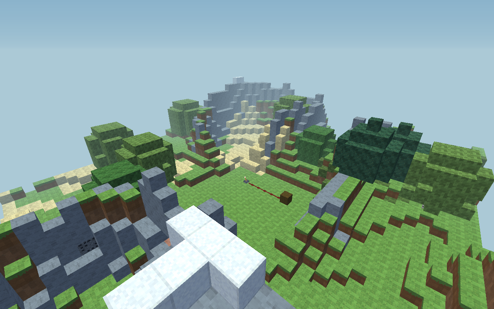

# Block Circuit — .NET 복셀 샌드박스

C# / .NET 10 + Raylib로 만든 싱글플레이·IP 직접 접속 멀티플레이 3D 게임입니다. 광질, 블록 건축, 레버·전선·램프 회로를 지원합니다. 마인크래프트에서 영감을 얻은 독립 프로토타입이며, 원작의 코드나 리소스를 사용하지 않습니다.

현재 **설치 가능한 블록 179종과 막대 아이템**, 36칸 슬롯 인벤토리(핫바 9칸 포함), 2×2/3×3 제작을 지원합니다. 기존 검색·분류 블록 라이브러리와 절차적 픽셀 텍스처도 유지합니다. 새 월드의 블록별 시작 수량은 128개이며, 핫바에 담지 못한 재료는 보관함에서 꺼낼 수 있습니다.

엔진의 P0 단계에서는 월드 데이터를 16×16×16 청크로 나누고, 변경된 청크만 다시 만드는 GPU 메시 캐시와 그리디 메시 병합을 적용했습니다. 현재 게임은 플레이어 주변 청크를 백그라운드에서 생성·로드하고, 멀어진 청크는 저장 후 메모리와 GPU에서 해제합니다. 기존 40×28×40 수평 경계를 넘어 음수 좌표로도 이동할 수 있습니다. 새 지형은 높이 0–63에 생성되고 건축·비행은 높이 255까지 지원합니다. 실제 플레이 좌표는 부동소수점 정밀도를 고려해 X/Z ±1,000,000으로 제한하며 저장 좌표는 정수 범위를 유지합니다. 구조와 검증 방법, 후속 단계의 범위는 [ENGINE-NOTES.md](ENGINE-NOTES.md)에 정리했습니다.

추가 개발에서는 **고정 20틱 시뮬레이션, 변경된 회로망만 갱신하는 회로 계산, 실행 취소·다시 실행, 충돌이 적용되는 비행과 설정 화면**을 제공합니다. 퀵바 구성과 화면·마우스 설정도 다음 실행에 유지됩니다.

## 그래픽·자연 지형 업데이트




태양 방향에 따른 따뜻한 조명과 주변광, 카메라 각도를 따라가는 하늘·태양, 거리 안개를 적용했습니다. 잔디·흙·돌·잎의 과한 픽셀 잡음과 격자 이음새를 줄였습니다. **F1**로 HUD를 숨겨 풍경을 볼 수 있습니다.

저장 파일이 없는 새 게임은 시드 **2026**의 자연 지형으로 시작합니다. 여러 크기의 노이즈와 좌표 왜곡, 능선 패턴을 조합해 높낮이를 만들고, 경사·습도에 따라 표면과 나무를 배치합니다. 지하에는 3차원 노이즈 기반 동굴이 생성됩니다. 자세한 구현과 참고 자료는 [GRAPHICS-TERRAIN.md](GRAPHICS-TERRAIN.md)에 있습니다.

**F6 → NATURAL → 시드 입력 → CREATE NEW WORLD**로 새 지형을 만들 수 있습니다. 입력 칸은 **Ctrl+A**로 지우고 정수를 입력하거나 **RANDOM**으로 바꿉니다. 생성 전에 현재 월드를 저장 폴더의 `backups/`에 보관합니다. 기존 저장 월드는 원래 블록 상태를 보존해 불러옵니다. 기존 영역 밖에는 스트리밍 지형을 생성하며, 모래·붉은 모래·자갈에는 중력을 적용합니다. 백업을 복원하려면 게임을 종료하고 백업 파일을 `world.json`으로 복사하세요.

최신 검증 빌드는 저장소의 **Actions → 성공한 Build and validate 실행 → Artifacts → BlockCircuit-windows-x64**에서 받을 수 있습니다. 압축을 모두 풀고 `BlockCircuit.exe`를 실행합니다. Windows의 빌드와 그래픽 없는 검사는 자동 실행하며, OpenGL 그래픽 검사는 Linux 소프트웨어 렌더러에서 수행합니다.

진행 중인 엔진 확장 작업의 현재 구조는 [아키텍처](docs/architecture.md), 단계별 상태와 검증 조건은 [로드맵](docs/roadmap.md), .NET 10 기준 측정은 [Phase 00 기준선](docs/baseline/2026-11-04/README.md)을 참고하세요.

## GitHub에서 소스 받기

저장소 위쪽의 **Code → Download ZIP**을 누르면 전체 소스를 받을 수 있습니다. 압축을 푼 뒤 `BlockCircuit.csproj`가 있는 폴더에서 아래의 .NET 실행 명령을 사용하세요. `bin/`, `obj/`, `dist/`는 빌드할 때 생성됩니다.

## Windows 실행

`BlockCircuit-windows-x64.zip`을 **전체 압축 해제**하고 `BlockCircuit.exe`를 실행하세요. .NET을 별도로 설치할 필요가 없습니다. Windows x64와 OpenGL 3.3을 지원하는 그래픽 환경이 필요합니다. Windows 배포본은 교차 빌드하며, 실제 Windows에서의 실행은 검증하지 않았습니다.

## IP 직접 접속 멀티플레이

**F8**에서 호스트는 **HOST WORLD**, 참가자는 호스트 IP·포트·비밀번호를 입력하고 **JOIN BY IP**를 누릅니다. 기본 포트는 TCP **25565**, 최대 **호스트 1명 + 참가자 8명**입니다. 같은 PC에서는 127.0.0.1, 같은 네트워크의 다른 PC에서는 호스트의 LAN IP를 사용합니다.

공동 건축·광질·회로와 플레이어 위치를 공유하고, 인벤토리·제작 재료는 플레이어별로 유지합니다. 다시 접속하면 같은 로컬 프로필의 소지품을 복원합니다. 참가 전에 개인 월드를 저장하며 **F8 → LEAVE / CLOSE SESSION**으로 돌아옵니다. 공유 월드 저장은 호스트가 담당합니다. 인터넷 접속은 해당 TCP 포트가 호스트까지 연결되도록 사용자가 네트워크를 설정해야 합니다.

[접속 방법과 기능 범위](docs/multiplayer.md), [실제 TCP·그래픽 검증](docs/validation/multiplayer/README.md)을 참고하세요.

## 조작

지원되는 동작은 [Minecraft 공식 조작 안내](https://www.minecraft.net/article/minecraft-controls)의 PC 기본 키를 따릅니다. 기존 8칸 퀵바 설정은 유지하고 9번에 유리를 추가합니다. 스크린샷은 저장 폴더의 `screenshots/`에 저장됩니다.

회로 디버거(F4), 새 월드(F6), 설정(F10), 저장·불러오기(Ctrl+S/O), 실행 취소·다시 실행(Ctrl+Z/Y)은 이 게임의 추가 단축키입니다. 아직 지원하지 않는 보조 손 교환(F), 채팅(T)은 별도 동작을 배정하지 않았습니다.

| 입력 | 동작 |
|---|---|
| WASD / 마우스 | 이동 / 시점 |
| Space | 점프; 누르고 있으면 착지 후 다시 점프 |
| 왼쪽 Ctrl / W 두 번 | 앞으로 달리기 |
| 왼쪽 Shift | 웅크리기; 지상에서 절벽 추락 방지 |
| 왼쪽 마우스 누르고 있기 | 광질; 재질마다 걸리는 시간이 다름 |
| 오른쪽 마우스 | 레버 조작 / 블록 설치; Shift를 누르면 레버 조작 대신 설치 |
| 1–9 / 마우스 휠 | 퀵바 슬롯 선택 |
| 가운데 마우스 버튼 | 바라보는 블록을 현재 퀵바 슬롯에 지정 |
| E | 슬롯 인벤토리·2×2 제작 열기/닫기; LIBRARY로 검색 화면 전환 |
| 제작대 우클릭 | 3×3 제작창 열기 |
| Q / Ctrl+Q | 아이템 하나 / 선택 스택 전체 버리기 |
| Ctrl+Z / Ctrl+Y | 마지막 편집 실행 취소 / 다시 실행 |
| Space 두 번 | 비행 켜기/끄기; 블록과 충돌 유지 |
| 비행 중 Space / 왼쪽 Shift | 상승 / 하강 |
| F1 | HUD 표시/숨기기 |
| F6 | 시드와 지형 방식을 선택해 새 월드 생성; 현재 월드 자동 백업 |
| F8 | IP 멀티플레이 호스트·접속·종료 |
| F3 | 엔진 디버그 정보 표시/숨기기 |
| F4 | 회로 디버그 정보와 신호 세기 표시/숨기기 |
| F2 | 스크린샷 저장 |
| F5 | 1인칭 → 후방 3인칭 → 정면 3인칭 |
| Ctrl+S / Ctrl+O | 월드 저장 / 불러오기 |
| F10 | 설정 화면 열기/닫기 |
| Esc | 열린 화면 닫기 또는 일시정지/재개 |
| 창 닫기 | 자동 저장 후 종료 |

인벤토리와 제작창에서는 이동과 광질이 일시정지됩니다. 왼쪽 클릭으로 이동·병합·교환하고 오른쪽 클릭으로 분할·하나 놓기, 드래그로 분배, Shift 클릭으로 빠르게 옮깁니다. 결과를 클릭하면 재료를 소비해 제작하고 Shift 결과 클릭은 공간이 허용하는 만큼 반복합니다. 제작 재료와 커서의 아이템도 저장됩니다. 자세한 조작과 34개 JSON 레시피는 [인벤토리·제작 문서](docs/inventory.md)에 있습니다.

**LIBRARY**로 기존 블록 라이브러리를 열 수 있습니다. 아래 슬롯을 클릭하거나 검색창에 입력 중이 아닐 때 **1–9**을 눌러 교체할 슬롯을 선택한 뒤, 원하는 블록을 클릭하세요. **E(검색 중이 아닐 때) / Esc / CLOSE**로 닫으면 선택한 블록을 설치할 수 있습니다. 슬롯 지정은 수량을 늘리지 않으며, 설치할 때 하나씩 소비하고 캐면 다시 회수합니다.

왼쪽 분류 버튼으로 재질을 고르고, 검색창을 클릭해 **영문 블록 이름**을 검색할 수 있습니다. 예를 들어 `diamond`, `cherry`, `blue`를 입력해 보세요. 검색은 현재 분류 안에서 이루어지므로 전체에서 찾으려면 `All blocks`를 선택합니다. 마우스 휠, `PREV` / `NEXT`, 또는 검색창에 입력 중이 아닐 때 **PageUp / PageDown**으로 페이지를 넘깁니다.

싱글플레이의 실행 취소는 성공한 **광질·설치·레버 조작을 최대 128회** 기억합니다. 멀티플레이에서는 공유 수량과 편집 충돌을 막기 위해 실행 취소·다시 실행을 지원하지 않습니다. 받침을 캐면서 함께 회수한 전선·레버와 인벤토리 수량도 같은 작업으로 복원합니다. 새 편집을 하면 다시 실행 기록이 지워지고, 월드를 불러오면 두 기록이 모두 초기화됩니다. 플레이어 몸 안에 블록을 복원하는 작업은 거부됩니다. 편집 기록은 게임을 종료하면 사라집니다. 낙하와 청크 언로드 등 시뮬레이션이 월드를 직접 바꾸면 충돌하는 수량 복원을 막기 위해 편집 이력을 초기화합니다.

20 TPS 이동·점프·입력 보존과 검증 결과는 [물리 시스템 문서](docs/physics.md)에 정리했습니다.

청크 스트리밍의 작업 예산·저장·좌표 한계는 [스트리밍 문서](docs/streaming.md), 중력 블록의 대상·착지·저장 규칙은 [낙하 문서](docs/falling-blocks.md)에 정리했습니다.

Registry 등록·이벤트·모드 ID 보존은 [Registry API](docs/registries.md), 청크 상태·원자적 저장·복구는 [저장 문서](docs/storage.md)를 참고하세요.

## 화면·조작 설정

**F10**에서 목표 FPS(30/60/120/144/240/무제한), 시야각(60–100도), 마우스 감도, 그리기 거리(32–128블록)를 바꿀 수 있습니다. 기본값은 60 FPS, 시야각 72도, 감도 1.00배, 그리기 거리 64블록입니다. 감도 조정 범위는 0.40–2.40배입니다. FPS 설정과 관계없이 이동·광질·설치·회로 변경은 초당 20틱으로 처리합니다.

설정 변경은 즉시 적용됩니다. **SAVE**를 누르면 설정과 퀵바 9칸·선택 슬롯을 월드 파일과 같은 폴더의 `settings.json`에 보관합니다. Ctrl+S 또는 정상 종료 시에도 월드와 함께 저장합니다. **RESET DEFAULTS**는 설정과 퀵바를 기본값으로 되돌립니다. 설정 파일이 없으면 기본값으로 시작하고, 읽을 수 없거나 형식이 잘못된 경우에는 기본 설정으로 시작하며 안내를 표시합니다.

## 블록 라이브러리

공기와 설치할 수 없는 기반암을 제외한 **179종**이 준비되어 있습니다.

| 분류 | 종류 | 대표 블록 |
|---|---:|---|
| Natural | 14 | 잔디, 흙, 모래, 붉은 모래, 자갈, 점토, 눈, 얼음, 진흙, 이끼, 균사체 |
| Wood | 25 | 참나무·자작나무·가문비나무·정글·아카시아·짙은 참나무·맹그로브·벚나무의 원목, 판자, 잎과 제작대 |
| Stone | 39 | 돌, 조약돌, 석재 벽돌, 화강암, 섬록암, 안산암, 심층암, 흑암, 사암, 흑요석, 석영, 프리즈머린 |
| Ores | 22 | 석탄·철·구리·금·레드스톤·청금석·다이아몬드·에메랄드·석영 광석, 광물 블록, 산화 단계별 구리 |
| Glass | 17 | 투명 유리와 16색 유리 |
| Wool | 16 | 16색 양털 |
| Concrete | 16 | 16색 콘크리트 |
| Terracotta | 16 | 16색 테라코타 |
| Decor | 11 | 호박, 수박, 건초 더미, 스펀지, 발광석, 바다 랜턴, 벌집, 꿀, 슬라임, 마그마, 자수정 |
| Circuit | 3 | Signal Wire, Lever, Circuit Lamp |

목재 결, 벽돌 줄눈, 광석, 직물 등은 게임이 생성하는 텍스처로 구분됩니다. 일반 재료와 장식 블록은 정육면체 건축 블록입니다. **모래·붉은 모래·자갈은 받침이 없으면 중력으로 떨어지고 착지합니다.** 낙하 중 위치·속도·블록 데이터도 저장합니다. 얼음의 미끄러짐, 슬라임의 반동, 꿀의 끈적임, 마그마의 피해, 스펀지의 물 흡수, 구리의 자동 산화는 구현하지 않았습니다. 발광석과 바다 랜턴은 밝은 외형의 장식이며 주변을 비추는 동적 조명은 없습니다. 레드스톤 광석은 광질용 블록이며 회로 신호는 `Circuit` 분류의 부품을 사용합니다.

## 월드와 저장

플레이어 이동에 따라 16×16 열의 청크 지형과 지하 통로가 이어집니다. 아직 로드되지 않은 지형은 충돌 경계로 처리하며 준비된 뒤 이동할 수 있습니다. 새 월드는 시드에 따른 산지·평지·지하 동굴과 광석·나무가 생성됩니다. 플레이어에게 중력과 블록 충돌이 적용되며, 바닥 기반암은 캘 수 없습니다.

저장 파일이 있으면 시작할 때 자동으로 불러옵니다. Ctrl+O를 누르면 마지막 저장 상태로 돌아가고, 창을 닫으면 현재 상태를 자동 저장합니다.

저장 위치는 Windows의 `%LOCALAPPDATA%\BlockCircuit\world.json`, Linux의 `~/.local/share/BlockCircuit/world.json`입니다. 정확한 위치는 .NET의 `LocalApplicationData` 경로를 따릅니다.

같은 폴더의 `game.log`에는 저장 결과나 설정·불러오기 오류를 기록합니다. 오류 안내가 나오면 이 파일로 원인을 확인할 수 있습니다.

**이전 버전의 저장 파일도 불러올 수 있습니다.** 기존 지형, 블록 수량, 회로와 플레이어 위치를 유지합니다. v1 저장을 이행할 때는 당시 없던 블록의 시작 수량도 채웁니다. 기존 영역은 다시 생성하지 않으며, 그 바깥의 새로 생성되는 영역에는 광석과 나무도 배치합니다. 새 지형으로 시작하려면 게임을 종료하고 `world.json`을 다른 이름으로 옮겨 보관한 뒤 다시 실행하세요. 퀵바 구성은 별도의 `settings.json`에서 유지합니다.

현재 저장 형식은 **v4**입니다. `world.json`에는 월드 메타데이터와 청크 참조를, `world.json.chunks/`에는 16³ 청크별 문자열 ID 팔레트와 상태를 저장합니다. 변경된 청크만 새 파일로 쓰며, 저장 완료 전에는 이전 파일을 유지합니다. 기존 v1/v2/v3 파일도 읽고, v4로 처음 저장할 때 원본을 `backups/`에 보존합니다. 손상된 현재 저장은 검증된 `world.json.bak`로 복구할 수 있습니다. 일반 v4 저장을 옮길 때는 JSON과 `.chunks/`, `.bak`를 함께 보관하세요. 새 월드 생성 시 만드는 v3 백업은 단독 복원이 가능한 파일입니다. 자세한 형식과 제한은 [저장 문서](docs/storage.md)에 있습니다.

## 회로 만들기

1. 평평한 땅 위에 `Lever`를 설치합니다. 기본 퀵바의 7번 슬롯입니다.
2. 레버 옆에서 `Signal Wire`를 이어 설치합니다. 기본 퀵바의 6번 슬롯입니다.
3. 전선 끝에 `Circuit Lamp`를 설치합니다. 기본 퀵바의 8번 슬롯입니다.
4. 레버를 바라보고 **오른쪽 마우스**를 누르면 전선과 램프가 밝아집니다.

시작 위치 앞에 예제 회로가 있습니다. 레버는 신호 15를 발생시키고, 전선/램프 한 칸마다 신호가 1 감소합니다. 신호는 면을 맞대는 상하좌우앞뒤 이웃으로만 전달됩니다. 대각선 연결이나 일반 블록을 통한 전도는 없습니다. 램프는 신호를 받지만 전달하지 않습니다. 전선·레버는 바로 아래에 단단한 블록이 필요하며, 받침을 캐면 회수됩니다. 단선하면 연결되지 않은 부분은 즉시 꺼집니다.

현재 회로는 레버·전선·램프의 기본 회로입니다. 피스톤·리피터·비교기·몹은 포함하지 않습니다.

## 소스에서 실행 및 검증

.NET 10 SDK를 설치하고 이 폴더에서 실행합니다.

```bash
dotnet run -c Release
```

Linux는 데스크톱 디스플레이와 OpenGL/X11 관련 라이브러리가 필요합니다. Windows/Linux x64를 대상으로 하며, macOS에서의 실행은 검증하지 않았습니다.

```bash
dotnet build -c Release
dotnet run -c Release -- --self-test
dotnet run -c Release -- --engine-tests
dotnet run -c Release -- --gameplay-tests
dotnet run -c Release -- --terrain-tests
dotnet run -c Release -- --controls-tests
dotnet run -c Release -- --streaming-tests
dotnet run -c Release -- --inventory-tests
dotnet run -c Release -- --multiplayer-tests
dotnet run -c Release -- --benchmark
dotnet run -c Release -- --circuit-benchmark
dotnet run -c Release -- --physics-benchmark
dotnet run -c Release -- --storage-benchmark
dotnet run -c Release -- --streaming-benchmark
dotnet run -c Release -- --falling-benchmark
dotnet run -c Release -- --inventory-benchmark
dotnet run -c Release -- --multiplayer-benchmark
dotnet run -c Release -- --multiplayer-session-benchmark
dotnet run -c Release -- --streaming-soak-test
```

헤드리스 검사는 기본 45개, 엔진 168개, 게임플레이 91개, 지형 55개, 조작 38개, 스트리밍 128개, 인벤토리·제작 63개, 멀티플레이 63개로 **총 651개**입니다. Debug/Release에서 모두 통과했으며, 실제 OpenGL 검사 10모드도 통과했습니다. [Phase05](docs/validation/phase05/README.md)와 [멀티플레이 검증 기록](docs/validation/multiplayer/README.md)에 수량 보존·저장 이행·성능 결과를 보존했습니다.

`--benchmark`는 CPU 메시 생성과 편집 부하를 `benchmark-results.json`에, `--circuit-benchmark`는 회로 계산 부하를 `circuit-benchmark-results.json`에 기록합니다. CPU 벤치마크와 실제 GPU의 FPS 측정은 구분합니다. 검사 결과와 측정 범위는 [엔진 노트](ENGINE-NOTES.md)에 있습니다.

디스플레이가 있는 환경에서 아래 명령은 각각 30프레임을 렌더링하고 미리보기 PNG를 저장한 뒤 종료합니다. 스모크 테스트는 기존 저장 파일을 불러오거나 덮어쓰지 않습니다.

```bash
dotnet run -c Release -- --smoke-test
dotnet run -c Release -- --palette-smoke-test
dotnet run -c Release -- --showcase-smoke-test
dotnet run -c Release -- --terrain-smoke-test
```

| 명령 | 출력 | 내용 |
|---|---|---|
| `--smoke-test` | `smoke-test.png` | 기본 월드와 게임 화면 |
| `--palette-smoke-test` | `palette-preview.png` | 블록 라이브러리 |
| `--showcase-smoke-test` | `blocks-preview.png` | 전체 블록 전시 |

실제 OpenGL 컨텍스트에서 GPU 캐시의 갱신과 수명을 확인하려면 다음 명령을 실행합니다.

```bash
dotnet run -c Release -- --engine-smoke-test
dotnet run -c Release -- --gameplay-smoke-test
dotnet run -c Release -- --controls-smoke-test
dotnet run -c Release -- --streaming-smoke-test
dotnet run -c Release -- --inventory-smoke-test
dotnet run -c Release -- --multiplayer-smoke-test
```

`--engine-smoke-test`는 정지 장면의 메시 재생성·GPU 업로드가 없는지, 블록 편집과 청크 경계에서 필요한 청크가 갱신되는지, 램프 전원이 외형을 갱신하는지, 청크 제거와 월드 재로딩 시 GPU 자원이 해제되는지 확인하고 `engine-smoke-results.json`에 기록합니다. `--gameplay-smoke-test`는 새 게임플레이 기능을 검증하고 `gameplay-smoke-results.json`과 `gameplay-preview.png`를 만듭니다. 자세한 판정 범위와 측정 결과는 [엔진 노트](ENGINE-NOTES.md)를 확인하세요.

## 배포 빌드

```bash
dotnet publish -c Release -r win-x64 --self-contained true -o dist/windows
python3 package.py
```

패키징 전에 위의 세 기본 미리보기 명령을 실행하세요. `package.py`는 상위 폴더에 `BlockCircuit-windows-x64.zip`과 `BlockCircuit-source.zip`을 만들고 ZIP 무결성을 확인합니다. Windows ZIP에는 실행에 필요한 .NET 런타임, README, 엔진 노트와 라이선스가 포함됩니다. 소스 ZIP에는 Assets/recipes.json을 포함한 콘텐츠 자원과 하위 폴더의 모든 C# 소스, 프로젝트 파일, 설명서, 패키징 스크립트, 라이선스와 미리보기 이미지가 포함됩니다. 존재하는 측정 JSON도 두 ZIP에 함께 포함하고, `engine-preview.png`·`gameplay-preview.png`·`terrain-preview.png`·`controls-preview.png`는 소스 ZIP에 추가합니다. `bin/`, `obj/`, `dist/`의 소스 파일은 제외합니다.

Raylib는 zlib/libpng 라이선스, Raylib-cs는 zlib 라이선스로 배포됩니다. 라이선스 전문은 `licenses/`에 있고, 코드의 종속성은 프로젝트 파일에 명시되어 있습니다.
