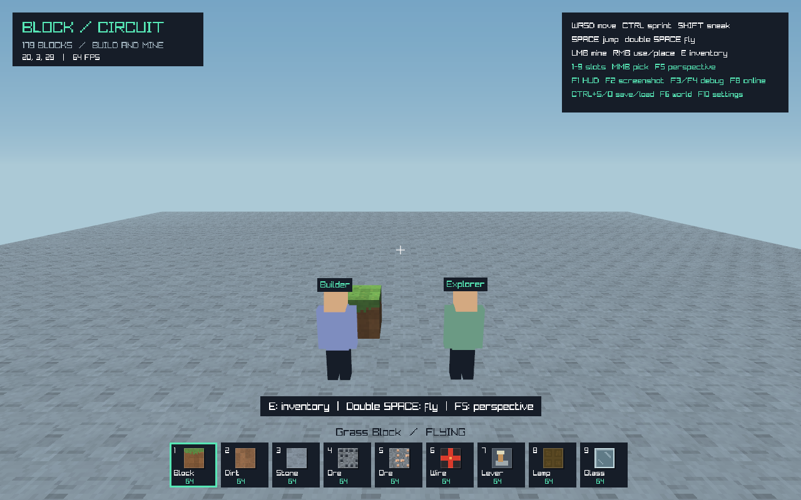
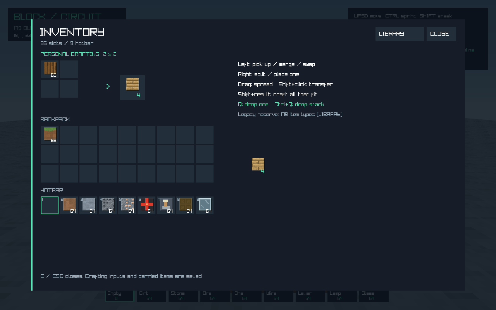

# IP 멀티플레이 검증

2026-11-05 (Asia/Seoul). Windows / .NET SDK 10.0.403 / 런타임 10.0.14에서 실행했다. 기준 커밋은 `365e03b0c95ee660c2ba86004edc3eb1c936c6c7`, 로컬 작업 브랜치는 `feature/inventory-crafting`이다. Phase05가 구현된 작업 트리에 사용자 요청으로 IP 직접 접속을 추가했다. 커밋·푸시는 하지 않고 스테이징까지만 한다.

## 실행 결과

- **Debug/Release 각각 651개 검사 통과**, 빌드 경고·오류 0개. 기존 Phase05까지 588개를 유지하고 실제 TCP 기반 멀티플레이 검사 63개를 추가했다.
- **Release OpenGL 10모드 통과**. 새 멀티플레이 모드는 실제 호스트 Game, 게스트 Game, 다른 TCP 참가자까지 함께 실행했다.
- 직접 IP/DNS·포트·선택 비밀번호로 접속한다. 최대 호스트1명 + 참가자8명이다. 이번 실제 게임 통합·성능 실험은 호스트와 참가자2명으로 수행했다.
- 호스트가 블록 설치·광질·회로·슬롯·제작·버리기/줍기를 승인한다. 게스트별 소지품·제작 입력·커서를 별도로 관리하고 저장·재접속을 지원한다.
- 호스트와 게스트의 서로 다른 관심 열을 로드하며, 게스트가 나간 열은 저장 후 언로드한다. 늦은 접속과 저장된 먼 위치 재접속도 청크를 받은 뒤 준비 상태가 된다.
- 참가 전의 개인 월드와 위치를 보존하고 나가면 복원한다. 게스트의 임시 복제 월드를 개인 저장으로 쓰지 않는다. 공유 중 호스트 메뉴에서도 월드 틱을 유지하고, 게스트는 월드/낙하를 독자적으로 시뮬레이션하지 않는다.

주요 변경은 `Multiplayer/NetworkProtocol.cs`, `NetworkTransport.cs`, `NetworkDtos.cs`, `MultiplayerSession.cs`, `Core/GameMultiplayer.cs`, `Core/MultiplayerSmoke.cs`, `World/NetworkWorld.cs`다. 기존 게임 루프·입력·인벤토리 제스처·제작·스트리밍·저장 복제와 CI/검증 명령도 연결했다. [사용 방법과 API 범위](../../multiplayer.md)를 따른다.

## 자동 검사 63개

실제 loopback TCP를 사용하며 모의 네트워크만으로 완료 처리하지 않았다.

| 범위 | 확인한 내용 |
|---|---|
| 전송 | 분할 prefix/본문, Unicode·Vector3 왕복, EOF·잘못된 JSON·중복 필드·길이 초과·음수 sequence, 수신 큐/접속 한도, 취소·소켓 종료 |
| 접속 | 버전·콘텐츠/레시피 지문·비밀번호, 거절 후 같은 배치의 hello 재시도, 중복 개인 프로필 거부, 공개ID와 비공개 재접속 ID 분리 |
| 권한 | 실제 두 참가자의 늦은 접속, 공유 편집·회로 복제, 충돌하는 설치·중복 요청·사거리/슬롯 거부, 누적 이동 예산 |
| 소지품 | 슬롯 의도·오른쪽 분배·Shift 이동, 개인 2×2 및 실제 제작대 3×3, 제작대 접근 거부, 버리기/지연 줍기와 오프라인 프로필까지 합산한 수량 보존 |
| 저장 | 개인 저장/호스트 소지품 보존, 게스트 저장·재접속, 잘못된 프로필의 로드 전 거부, 작업 스레드의 호스트 Pump 거부 |
| 스트리밍 | 호스트가 멀어져도 게스트의 열 유지, 퇴장 시 변경 열 저장/언로드, 재접속 때 표식 복원, 상주4열/로드2개/통합1·언로드1·캡처2·전송2 예산 |

[Debug 상세 로그](Debug-multiplayer-tests.log), [Release 상세 로그](Release-multiplayer-tests.log). 나머지 일곱 회귀 모드의 로그도 함께 보존했다. 실제 Game 통합 검사는 별도 네이티브 모드로 수행했다.

## 네이티브 게임 통합

31프레임 동안 두 게스트를 실제 TCP로 연결해 상대 아바타·이름과 공유 블록을 그렸다. 게스트의 실제 Game 입력/제스처 경로에서 블록 설치, 소유한 원목 선택·제작 입력 이동·판자 제작을 전송하고 호스트의 확정을 확인했다. 호스트 메뉴가 열린 동안 2틱 진행했고, 게스트가 나간 뒤 원래 개인 월드 객체·블록·인벤토리가 같음을 확인했다.

호스트 GPU 메시 할당9개/해제9개, 게스트9개/해제9개, 종료 후 GPU 버퍼 0개다. 새 전용 창은 loopback 임시 세션만 열며 기존 사용자 저장을 읽거나 덮어쓰지 않는다. 짧은 렌더·수명 검사이며 실제 WAN이나 장시간 안정성·지속 FPS 측정은 아니다. [원시 결과](multiplayer-smoke-results.json), [실행 로그](Release-multiplayer-smoke-test.log)





## 실제 호스트·두 참가자 CPU/전송 측정

실제 경과 시간으로 60Hz 드라이버와 20TPS를 누적했다. 준비250ms 뒤, 변경240프레임과 유휴120프레임을 측정했다. CPU 시간은 월드 틱·요청 제출·호스트/클라이언트 Pump를 포함하고 프레임 간 대기는 제외한다. 파일 I/O·GPU·WAN 지연을 포함하지 않는다.

| 항목 | 변경 구간 | 유휴 구간 |
|---|---:|---:|
| 실제 경과 시간 | 4.0007003초 | 2.0010972초 |
| 틱 | 실제80 = 기대80 | 실제40 = 기대40 |
| 버린 시뮬레이션 시간 | 0초 | 0초 |
| CPU P50 / P95 / P99 | 0.2998 / 3.4273 / 6.4130ms | 0.1537 / 0.3378 / 0.4839ms |
| 최대 CPU 시간 | 36.5987ms | 0.7629ms |
| 두 참가자 합산 송신/수신 바이트 | 21,647 / 1,313,731B | 8,636 / 478,720B |
| 청크/상태 메시지 | 36 / 140 | 0 / 68 |
| 전체 스레드 관리 할당 | 56,393,312B | 20,476,936B |

설치·채굴10회와 스위치8회의 요청 18개가 모두 승인되고, 실제 편집 수량과 다른 참가자/호스트의 소지품 보존을 검증했다. 관측 최대 청크 전송은 Pump당2개, 클라이언트 수신 큐 표본은2메시지·15,836B였다. 유휴 구간의 변경 없는 청크 재전송은0개다. 상태는 평상시 50ms 주기로 보내며 명령 확정 후 추가 전송한다.  표의 수신/송신량은 4바이트 prefix를 포함하고 TCP/IP 헤더는 제외한다. 백그라운드 경계 메시지는 측정 구간을 넘나들 수 있다. 모든 클라이언트와 리스너 소켓이 종료됐다. [원시 결과](multiplayer-session-benchmark-results.json)

추가로 4096셀 청크와 확인 응답을 20회 준비 후200회 실제 왕복했다. 모두 디코딩해 비교했고 총 애플리케이션1,683,000B, P50 3.6538ms / P95 4.3232ms / P99 4.6509ms, 최대5.6526ms, 전체 스레드 관리 할당39,055,000B였다. 1ms 소유 스레드 폴링과 JSON·스케줄링을 포함하며 네트워크 RTT만의 측정은 아니다. [원시 결과](multiplayer-benchmark-results.json)

기존 메시·회로·물리·저장·스트리밍·낙하·인벤토리 벤치마크도 통과했다. 메모리 할당 합계는 상주 메모리·누수 부재를 증명하지 않는다.

## 구현 한도와 미검증 범위

- IPv4/LAN 또는 호스트까지 연결 가능한 직접 TCP가 필요하다. 외부 PC·인터넷/공유기·포트 전달 환경은 이번에 실측하지 않았다. 프로그램이 방화벽/공유기를 자동 변경하지 않는다.
- 친구 초대·로비·전용 서버 서비스·TLS·호스트 이전은 없다. 호스트를 닫으면 세션이 끝난다. 공유 비밀번호와 개인 프로필은 이 버전의 접속/소지품 복원 경계다.
- 이동은 클라이언트에서 표시하고 호스트가 누적 이동·로드 상태·쓸림 충돌을 검사한다. 서버가 모든 입력을 물리적으로 재시뮬레이션하는 예측/재조정이나 전문 치트 방지는 아니다. 채굴의 첫 요청은 사거리/블록을 확인하고 승인할 수 있으며 후속 요청은 쿨다운으로 제한한다.
- PvP·아바타 간 물리 충돌·채팅·스킨은 없다. 블록 설치/낙하의 플레이어 겹침은 검사한다. 일반 엔티티와 pickup 투척 물리는 후속 범위다.
- 참가자마다 기본 청크 반경2열(5×5열), 소지품 프로필 저장 최대128개다. 프로토콜은8MiB 프레임·128메시지/16MiB 큐를 제한하고, 느린/잘못된 연결은 종료한다.
- 입력 처리는 Pump당 전역64메시지/약4ms 문턱·참가자당8개, 반복 제작은 요청당64회, 청크는 참가자당2개/전체8개로 제한한다. 한 명령의 완료 시간까지 강제로 중단하는 실시간 스케줄러는 아니다.
- 로컬 Windows에서 검증했다. 양 OS 헤드리스 CI와 Linux 네이티브 명령을 추가했으나 원격 CI는 실행하지 않았다. 새 의존성은 추가하지 않았다. Phase06 조명·낮밤과 이후 일반 엔티티를 완료로 표시하지 않는다.

## 재현

```powershell
./scripts/validate.ps1 -Configuration Debug -OutputDirectory artifacts/multiplayer-debug
./scripts/validate.ps1 -Configuration Release -OutputDirectory artifacts/multiplayer-release -Benchmarks -Graphics
```

개별 실행: `--multiplayer-tests`, `--multiplayer-benchmark`, `--multiplayer-session-benchmark`, `--multiplayer-smoke-test`. 실제 플레이는 **F8 → HOST WORLD / JOIN BY IP**다. 기본 TCP 포트는25565다.
