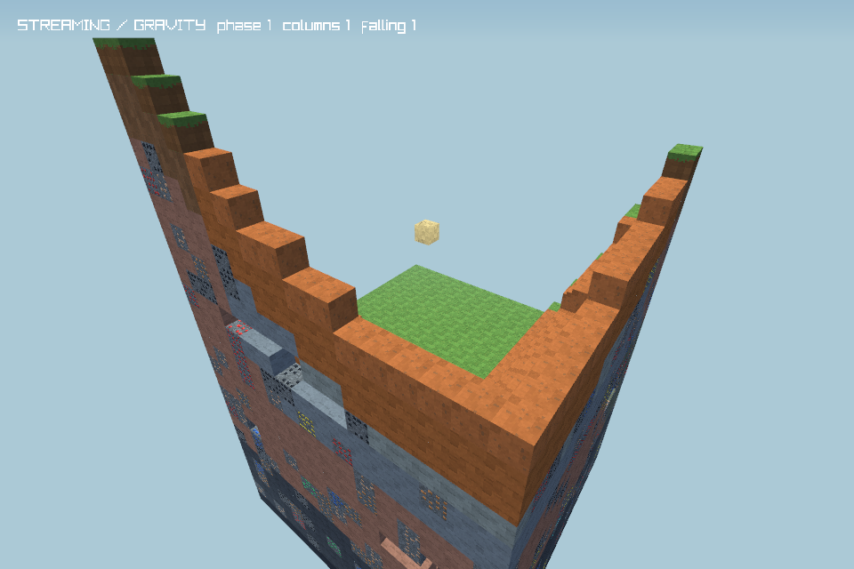

# Phase 04 스트리밍 및 블록 중력 검증

검증일: 2026-11-05 (Asia/Seoul). Windows 10.0.26200, .NET SDK 10.0.403 / 런타임 10.0.14, Raylib-cs 6.1.0 / OpenGL에서 실행했다. 기준 커밋은 `db8e213dd9cd9c36ed5e95b720933877df16e733`이며, 이 기록은 그 이후 Phase 04 작업 트리를 대상으로 한다. 사용자 지시에 따라 변경은 스테이징까지만 하고 커밋·푸시는 하지 않는다.

## 구현 결과

- 플레이어 주변 열(column)을 우선순위에 따라 생성·로드하고, 멀어진 열은 변경분을 저장한 뒤 언로드한다. 시드와 전역 좌표로 지형·동굴·광석·나무를 결정하며, 음수 좌표와 열 경계, 재진입을 지원한다.
- 지형 생성·청크 파일 읽기·CPU 메시 생성·저장 파일 쓰기는 백그라운드 작업으로 실행한다. 월드 통합과 저장용 DTO 캡처는 소유 스레드, GPU 업로드·해제는 렌더 스레드에서 수행한다. 취소되거나 이전 청크 세대에 속한 결과는 게시하지 않는다.
- 로드 작업 최대 2개, 프레임당 열 통합 1개·언로드 1개·변경 청크 캡처 2개·청크 GPU 업로드 2개로 제한한다. API 기본 상주 열 한도는 256개, 실제 게임은 512개로 설정한다. 아래 이동 검사는 더 작은 16개 한도로 수행했다.
- 모래·붉은 모래·자갈은 받침이 없어지면 낙하한다. 낙하 중 상태·식별자·확장 데이터와 대기 중 중력 처리를 저장하며, 로딩 경계나 플레이어와 겹치는 착지는 대기한다. 블록 수량과 인벤토리를 보존한다.
- 기존 유한 월드 및 구형 저장의 호환 검사를 유지했다. 스트리밍 저장은 비상주 청크 참조를 보존하고, 독립 백업은 해당 청크를 포함한다. 저장 실패·오래된 저장 완료 통지·저장 중 재수정·새 월드 전환을 검사했다.

주요 파일은 `World/StreamingTerrainGenerator.cs`, `World/WorldStreamer.cs`, `World/StreamingSaveSession.cs`, `World/StreamingWorld.cs`, `World/FallingBlockSystem.cs`, `Rendering/ChunkMeshScheduler.cs`, `Core/GameStreaming.cs`다. 렌더러·충돌·저장·게임 진입 경로와 검증 스크립트/CI도 연결했다. 동작 계약은 [스트리밍](../../streaming.md), [낙하 블록](../../falling-blocks.md), [저장](../../storage.md)에 기록했다.

## 빌드 및 회귀 검사

Debug와 Release 빌드 모두 경고 0개·오류 0개, 구성별 **525개 검사 통과**. 기존 397개 검사를 유지하고 다음 128개를 추가했다.

| 검사 | 개수 |
|---|---:|
| 시드·좌표·순서·병렬 생성·취소 | 16 |
| 스트리밍 충돌·이동·회로 받침 | 16 |
| 비동기 CPU 메시 및 수명 | 25 |
| 스트리밍 로드·예산·언로드·저장 | 25 |
| 저장 무결성 및 변경분 경합 | 6 |
| 중력·수량 보존·경계·등록 메타데이터 | 27 |
| 낙하 중 저장·복원·알 수 없는 콘텐츠·백업 | 13 |

각 구성의 `*-self-test.log`, `*-controls-tests.log`, `*-terrain-tests.log`, `*-gameplay-tests.log`, `*-engine-tests.log`, `*-streaming-tests.log`에 상세 결과를 보존했다.

Release 네이티브 OpenGL 검사 **8모드**(기본·팔레트·지형·쇼케이스·게임플레이·조작·엔진·스트리밍) 모두 통과했다. 새 스트리밍 모드는 150프레임/50틱 동안 실제 낙하 렌더링과 백그라운드 메시 완료를 확인했다. 작업 스레드의 GPU 호출을 거부하고, 프레임당 업로드 최대 2개를 지켰다. GPU 할당 7개를 모두 해제했고 종료 후 VBO는 0개였다. 프레임 P95 16.6774ms / P99 18.6409ms는 60 FPS 제한 대기·렌더링·검사용 단언을 포함한 한 장비의 관측값이다. [원시 결과](streaming-smoke-results.json)



## CPU 및 저장 측정

| 시나리오 | 결과 |
|---|---|
| 멀리 떨어진 3×3 열 구역 12곳 이동(2곳 준비 후 측정) | 280프레임, 스트리머 Update P50 0.2625ms / P95 0.6963ms / P99 0.9716ms, 최대 5.8317ms |
| 같은 이동의 상주/작업 한도 | 최대 16열·45청크·로드 작업 2개, 프레임 통합/언로드/캡처 최대 1/1/2개 |
| 저장 후 재진입 | 117열 언로드, 이전 편집 복원 및 인벤토리 동일성 통과; 마지막 명시적 저장 대기 86.0127ms |
| 모래 512개, 각기 다른 X/Z·Y48에서 낙하 | 117틱 내 512개 모두 착지, 모든 변경 통지에서 수량 보존, 인벤토리 동일 |
| 위 낙하의 World.Tick CPU 시간 | P50 1.2516ms / P95 1.5531ms / P99 1.9776ms, 최대 6.164ms, 합계 154.4398ms |
| 위 낙하의 관리 힙 할당 | 205,504바이트, 틱당 대기 셀 검사 최대 512개·활성 낙하 갱신 최대 256개 |

이동 측정은 백그라운드 생성·저장과 함께 수행한 소유 스레드 Update 시간이며 실제 렌더 FPS 측정은 아니다. 준비 후 GC 힙 1,248,448바이트 → 이동 후 GC 힙 2,548,624바이트, 이동 및 마지막 저장의 전체 스레드 할당 합계는 95,300,376바이트였다. CLR 캐시·측정 자료·방문한 지형 인덱스가 포함된다. [스트리밍 원시 결과](streaming-benchmark-results.json), [낙하 원시 결과](falling-benchmark-results.json)

기존 메시·회로·물리·저장 벤치마크도 통과했다. 정적 메시 캐시 300회 재빌드 0개, 편집 2,000회 후 기준 메시 비교, 회로 기준 구현 비교, 물리 100,000틱의 관리 힙 할당 0바이트를 확인했다. 각 `*-benchmark-results.json`과 Release 로그에 범위와 결과를 기록했다.

## 실제 시간 120초 연속 이동

별도 `--streaming-soak-test`는 실제 경과 시간을 20 TPS로 누적하며 120.0051891초 동안 실행했다. **기대 2,400틱 = 실제 2,400틱**, 버린 시간은 0초였다. 렌더링이 없는 이동·생성·저장 검사이며, OpenGL 프레임 시간 검사는 위 네이티브 모드로 분리했다.

- Update 7,744회: P50 0.0089ms / P95 0.3273ms / P99 0.5355ms, 최대 19.7258ms.
- 상주 최대 16열·47청크, 로드 작업 최대 2개, 프레임당 통합/언로드/캡처 최대 1/1/2개.
- 표식 53개 생성, 실행 중 재방문 7회, 저장·폐기·재로드 후 표식 3개 복원 확인.
- 폐기 후 남은 로드 작업 0개, 진행 중 저장 없음.
- 최종 방문 열 인덱스 477개·저장 청크 참조 1,211개. 저장 후 강제 GC 힙 6,335,944바이트, 모든 소유자 폐기 후 강제 GC 힙 7,159,152바이트, 전체 스레드 할당 합계 900,051,896바이트.

상주 청크는 제한되지만 방문 열/저장 파일 인덱스는 탐험량에 따라 증가한다. 20초 간격의 강제 GC 없는 힙 표본은 약 12.6/14.7/21.7/25.8/25.1/20.9MB였다. 이는 프로세스 작업 집합이나 누수 부재를 증명하는 값이 아니다. 장시간·전체 시스템 통합 성능은 Phase 12에서 추가 측정한다. [원시 결과](streaming-soak-results.json), [실행 로그](Release-streaming-soak-test.log)

## 알려진 한계와 미검증 범위

- 실제 플레이 좌표는 X/Z ±1,000,000 범위, 자연 지형은 Y0–63, 건축은 Y0–255다. 내부 정수 좌표의 범위와 실제 플레이 범위는 다르다. 로딩되지 않은 경계는 이동·편집을 제한해 데이터 덮어쓰기나 추락을 막는다.
- 기존 월드 영역은 보존하며 바깥쪽에 새 생성기를 적용한다. 구형 영역과 새 지형 사이에 절벽이나 부분적으로 빈 경계가 생길 수 있다.
- 평상시 저장 파일 처리는 비동기지만 명시적 저장·내보내기·최초 저장 검증·종료 flush는 동기 대기할 수 있다. 저장 열 읽기 한도는 16MiB이고, 방문 인덱스·메타데이터 한도·메모리·디스크 용량도 월드 크기의 실제 한계다.
- 틱당 활성 낙하 256개 예산 때문에 대량 낙하는 개별 블록 갱신 간격이 늘어난다. 위 512개 실험은 117틱에 착지했다. 일반 엔티티·낙하 피해·아이템 엔티티는 Phase 09 범위다.
- 이번 로컬 검증은 Windows에서 수행했다. Windows/Linux CI에 스트리밍 검사를 추가했지만 원격 CI는 아직 실행하지 않았다. 배포본 생성·실행과 Phase 05–13의 시스템은 완료로 주장하지 않는다.

## 재현

저장소 루트의 PowerShell에서 실행한다. 출력 디렉터리를 분리하므로 기존 Debug 실행 파일과 충돌하지 않는다.

```powershell
./scripts/validate.ps1 -Configuration Debug -OutputDirectory artifacts/phase04-debug
./scripts/validate.ps1 -Configuration Release -OutputDirectory artifacts/phase04-release -Benchmarks -Graphics
Push-Location artifacts/phase04-release
dotnet ../build/Release/BlockCircuit.dll --streaming-soak-test | Tee-Object -FilePath Release-streaming-soak-test.log
Pop-Location
```

120초 검사는 일반 회귀 검사 및 CI의 기본 실행에 넣지 않았다. 실행 로그와 JSON은 이 디렉터리에 보존했다.
