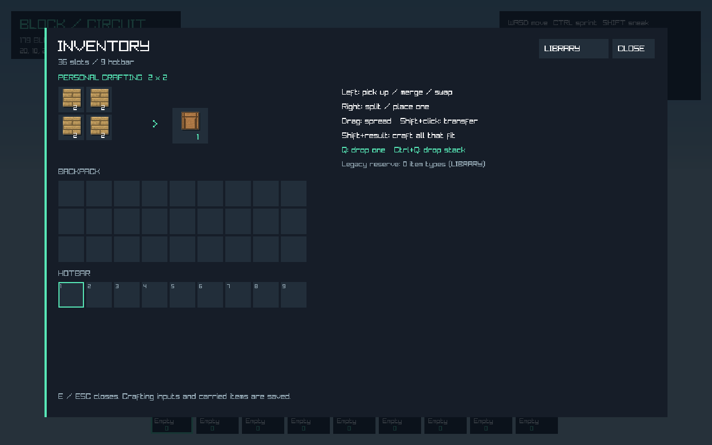
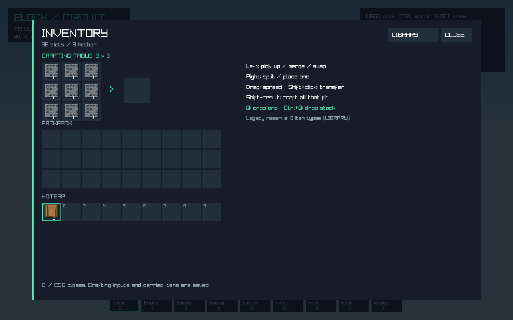
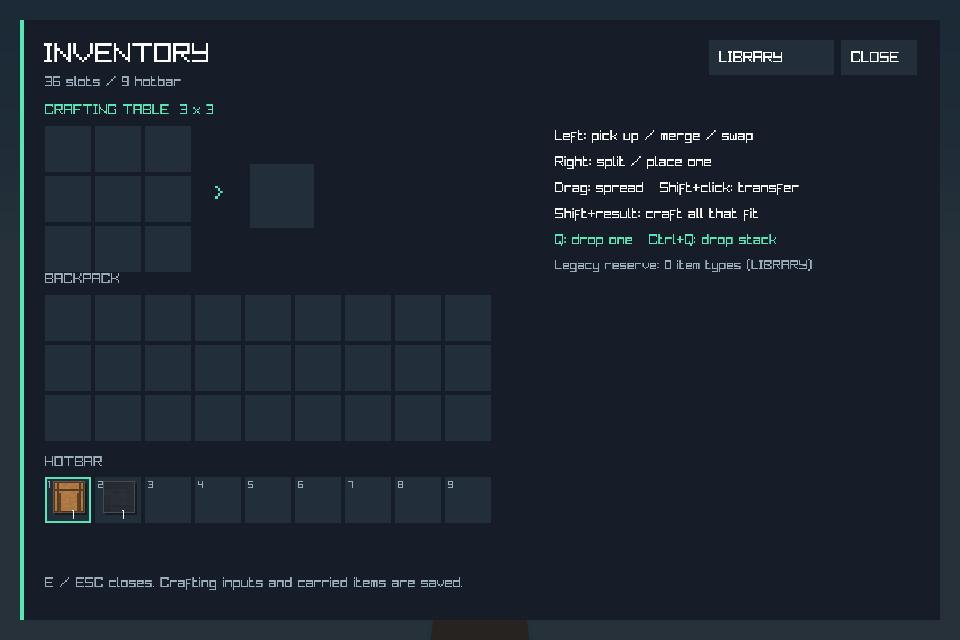

# Phase 05 인벤토리·제작 검증

2026-11-05 (Asia/Seoul), Windows 10.0.26200 / .NET SDK 10.0.403 / .NET 런타임 10.0.14에서 실행했다. 기준 커밋은 `365e03b0c95ee660c2ba86004edc3eb1c936c6c7`, 로컬 작업 브랜치는 `feature/inventory-crafting`이다. 변경은 사용자 지시대로 git add까지만 수행하며 커밋·푸시는 하지 않는다.

## 구현과 변경 범위

- 36칸 중 핫바 9칸과 가방 27칸, 별도 2×2/3×3 제작 입력·커서·기존 수량 보관함을 구현했다. 등록된 스택 한도, 이동·병합·분할·교환·균등/한 개씩 드래그·Shift 이동을 지원한다.
- 기존 수량은 핫바를 우선 배치하고 나머지를 보관함에 남겨 손실을 막는다. 실제 설치는 선택 슬롯만 소비하고 가방이 가득 차면 수집 불가능한 광질을 거부한다. 설치/광질 실행 취소는 슬롯 배치까지 복원한다.
- 제작대 블록(ID180)을 기존 ID 뒤에 추가하고 막대를 등록했다. 기존 숫자 0–179는 유지한다. JSON 레시피 34개, shaped 이동·반전 및 shapeless 중복 재료 비교, 결과를 받을 때만 원자적으로 차감하는 제작을 연결했다.
- E로 개인 제작창, 제작대 우클릭으로 3×3 제작창을 열고 LIBRARY에서 기존 검색·분류 화면으로 이동한다. 1280×800 및 최소 960×640에서 실제 화면을 확인했다.
- Q/Ctrl+Q 버리기, 제한된 정지 pickup 표시, 20틱 지연 후 가까이 가면 수집하는 경로를 추가했다. GUID·수량·위치·지연을 저장한다.
- v3/v4에 선택적 ItemInventory를 추가하고 기존 Counts와 교차 검증한다. 슬롯·입력·커서·보관함·pickup, 미등록 모드 아이템을 보존한다. 180개 수량의 구형 v2도 읽는다.
- 첫 v4 슬롯 이행은 원본 JSON과 참조 청크를 별도 백업한다. 이후 원래 청크 버전이 정리되어도 백업을 복원할 수 있으며, 손상된 현재 저장을 .bak에서 복구한 뒤 이행·다시 저장하는 경로도 검사했다.

주요 코드는 `Inventory/PlayerInventory.cs`, `Inventory/InventoryGesture.cs`, `Inventory/RecipeBook.cs`, `World/WorldInventory.cs`, `Core/InventoryPanel.cs`, `Core/InventorySmoke.cs`, `Assets/recipes.json`이다. 기존 World·저장·편집 이력·게임 입력/HUD·레지스트리·패키징·검증/CI도 연결했다. 상세 계약은 [인벤토리 문서](../../inventory.md)를 따른다.

## 회귀와 저장 무결성

Debug/Release 빌드 모두 **경고 0개·오류 0개**, 각각 **588개 검사 통과**. 기존 525개를 유지하고 아래 63개를 추가했다.

| 새 검사 | 개수 | 주요 검증 |
|---|---:|---|
| 인벤토리 모델 | 16 | 한도·가득 참·분할·드래그·정수 최대 수량 이행, 10,000회 시드 기반 조작의 수량 보존 |
| UI 제스처 컨트롤러 | 7 | 클릭 후 커서 유지, 왼쪽/오른쪽 드래그, Shift, 취소, 교체된 월드로의 오래된 드래그 거부 |
| 제작 | 14 | 2×2/3×3·모양/순서·중복 재료·추가 입력·잘못된 JSON 정의·출력 공간 부족 시 원자성 |
| 저장·월드 통합 | 26 | 30회 편집/저장/재로드, 실행 취소·가방 가득 참·한 번만 줍기·구형/누락 모드·실패 주입·비동기 복사·원본 백업/복구 |

각 구성의 `*-inventory-tests.log`와 나머지 여섯 회귀 로그에 상세 결과를 보존했다. 누락 모드 아이템은 모드 없이 다시 저장한 뒤 재등록해 수량과 슬롯을 확인했다. 잘못된 슬롯 저장은 활성 월드/소지품을 바꾸기 전에 거부하며, 매니페스트 커밋 직전의 실패 주입은 이전 저장 파일을 보존한다.

## 네이티브 OpenGL

기존 8모드와 새 인벤토리 모드까지 **9모드 통과**. 새 모드는 100프레임 동안 개인 제작·제작대·라이브러리·최소 창 크기를 실제로 렌더링하고 제작대 2개 제작, 버리기, 저장·재로드를 확인했다. 창을 닫기 전에 렌더러를 폐기했다. 클릭/드래그 전이는 실제 UI와 공유하는 제스처 컨트롤러의 헤드리스 검사로 검증했다.

최대 프레임 163.3105ms는 첫 유한 테스트 월드의 동기 메시/GPU 준비와 60 FPS 대기를 포함하는 smoke 전체의 관측값이다. 일반 플레이의 지속 FPS나 지연 상한으로 해석하지 않는다. 기존 엔진의 125프레임 캐시/GPU 수명 검사와 스트리밍 GPU 검사도 통과했다. [네이티브 결과](inventory-smoke-results.json), [실행 로그](Release-inventory-smoke-test.log)







## CPU·할당 실측

시나리오마다 50회 준비 후 소유 스레드에서 측정했다. GPU·파일 I/O·프레임 시간 측정은 아니다.

| 시나리오 | 표본 | P50 / P95 / P99 | 최대 | 관리 힙 할당 합계 |
|---|---:|---|---:|---:|
| 실제 슬롯에서 설치 후 실행 취소 | 2,000회 | 0.0125 / 0.0228 / 0.0288ms | 0.5814ms | 45,568,000B |
| 3×3 압축 → 2×2 해제 → 입력 재분배 | 500회 | 0.0814 / 0.0948 / 0.2085ms | 0.3557ms | 18,812,000B |

각 시나리오 종료 후 원래 슬롯 배치 및 광석 9개의 수량을 검증했다. 할당에는 트랜잭션/제작 후보 스냅샷이 포함된다. 상주 메모리나 장시간 누수 부재를 증명하는 측정은 아니다. [원시 측정](inventory-benchmark-results.json)

기존 메시·회로·물리·저장·스트리밍·낙하 벤치마크도 통과했다. 원본 JSON/로그를 이 폴더에 보존했다. 120초 스트리밍 검사는 Phase04 기록을 유지하며 이번에는 다시 실행하지 않았다.

## 남은 범위

- pickup은 정지한 소형 큐브다. 투척/낙하 물리·엔티티 충돌·자동 소멸·일반 엔티티 엔진은 Phase09에 남아 있다.
- 기본 레시피는 이 게임의 현재 블록을 사용한다. 제련·내구도·재료 태그/대체 재료·레시피 파일 감시를 구현하지 않았다.
- 구형 v4 원본 백업은 JSON과 해당 `.chunks` 폴더를 함께 복원한다. 원본부터 손상돼 누락된 청크는 원본 백업에서 새로 만들지 않는다. 정상 .bak를 보존해 복구한다.
- 현재 아이템 등록 한도를 넘긴/잘못된 슬롯 저장은 자동 절삭하지 않고 거부한다. 레거시 Inventory 배열은 슬롯 모드에서 직접 수정하지 않는다.
- Windows 로컬 결과다. 양 OS CI 검사와 Linux 네이티브 명령을 추가했으나 원격 CI는 실행하지 않았다. 레시피는 빌드 출력에 실제 복사되어 검사에 사용됐다. publish 실행·ZIP 배포 검증은 Phase13에 남겼고, 이 환경의 Python 실행 별칭은 사용 가능한 런타임을 제공하지 않아 package.py 실행은 검증하지 않았다.

## 재현

```powershell
./scripts/validate.ps1 -Configuration Debug -OutputDirectory artifacts/phase05-debug
./scripts/validate.ps1 -Configuration Release -OutputDirectory artifacts/phase05-release -Benchmarks -Graphics
```

개별 모드는 `--inventory-tests`, `--inventory-benchmark`, `--inventory-smoke-test`다. 실제 사용자 저장 대신 임시 테스트 월드를 사용한다. 다음 단계는 Phase06 조명 및 낮·밤이다.
