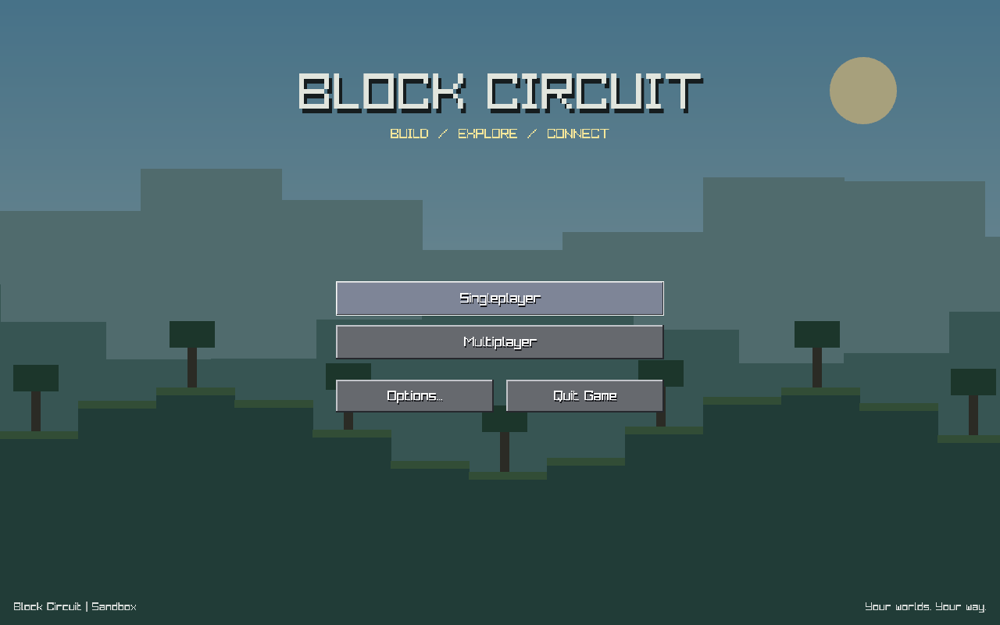
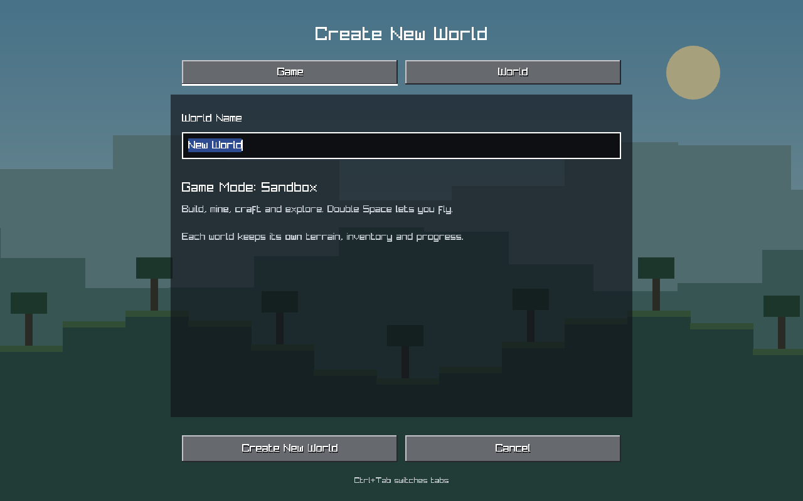
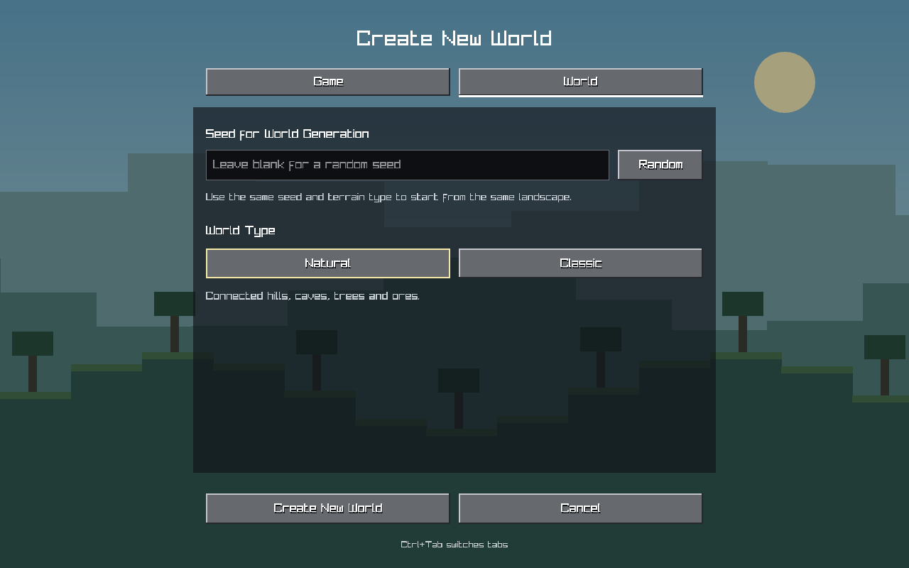
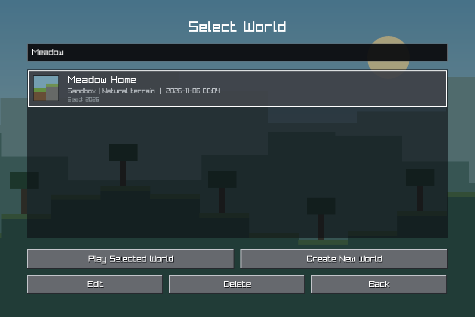
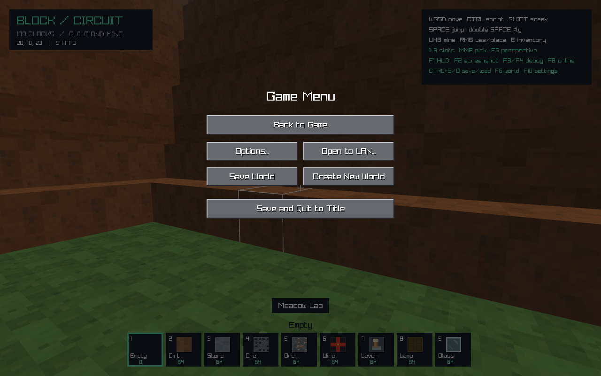
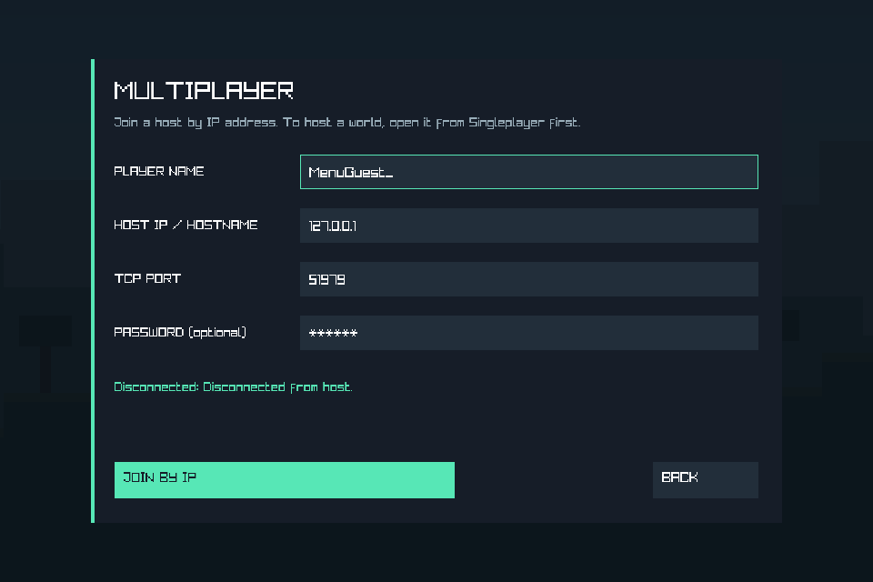

# 처음 실행·월드 생성 UX 검증

검증일: 2026-11-05–06 (Asia/Seoul). Windows x64, .NET SDK 10.0.403, Raylib-cs 6.1.0의 실제 OpenGL 창에서 실행했다. [구현·공식 조사 자료](../../startup-ux.md), [원시 수치](summary.json)를 함께 보존한다.

## 빌드와 회귀 검사

Debug/Release 빌드는 모두 경고 0, 오류 0이었다. 각 구성에서 아래 707개가 통과했다.

| 검사 | 수 |
|---|---:|
| 기본 | 45 |
| 엔진·청크·Registry | 168 |
| 게임플레이 | 91 |
| 지형·세션 | 55 |
| 조작·카메라 | 38 |
| 스트리밍·저장·낙하 | 128 |
| 인벤토리·제작 | 63 |
| 멀티플레이 | 63 |
| 새 월드 보관함·시작 흐름 | 56 |
| 합계 | 707 |

시작 검사는 WorldLibrary 28개와 StartupFlow·텍스트 편집 28개다. 임시 폴더의 실제 저장으로 월드별 독립성, 중복 이름·시드, 메타데이터와 지형 분리, 명시적 백업, 기존 world.json과 복구 저장 발견, 손상 항목 격리, Trash 보관, 활성 저장 잠금 중 삭제 거부를 확인했다. [Debug 로그](Debug/Debug-startup-tests.log), [Release 로그](Release/Release-startup-tests.log).

## 실제 게임 창과 세션

두 구성에서 smoke, palette, showcase, terrain, engine, gameplay, controls, streaming, inventory, multiplayer, startup의 11개 그래픽 모드가 모두 종료 코드 0으로 완료됐다. [Debug](Debug/), [Release](Release/)에 모드별 로그와 JSON을 보존했다. Debug 전체 검사 뒤 연결 취소·오류 표시 수정을 적용한 다음, 영향을 받는 멀티플레이 검사와 multiplayer/startup 그래픽 모드를 다시 실행한 결과가 해당 로그에 들어 있다. Release는 기능 변경으로 전체 검사를 실행했다. 마지막 메뉴 열기 클릭 전달 방지를 적용한 뒤 두 구성의 startup/gameplay/multiplayer 그래픽 검사를 재실행했고, 기본 폰트 문구 수정 뒤 startup 검사를 다시 실행했다. 각 폴더에는 최신 결과와 경고·오류 0인 최종 build.log가 들어 있다.

새 --startup-smoke-test는 일반 Game 생성자에 격리된 임시 앱 데이터 경로를 주고 실제 화면 렌더러와 세션 핸들러를 실행한다. 물리 마우스·키보드 입력을 자동화한 검사는 아니며, 메뉴 입력 해석은 코드 검토와 별도 상태 검사로 보완했다. 실제 창의 PNG를 열어 1280×800과 최소 크기 960×640 배치를 확인했다.

37개 네이티브 검사에는 다음 동작이 포함된다.

- 월드 파일·지형 없이 타이틀 표시, 빈 Singleplayer 생성 안내, 생성 취소 후 빈 목록 복귀.
- 로딩 화면을 한 번 그리기 전에는 작업을 발행하지 않음. 스폰 열·바닥·몸과 머리 공간·렌더 준비 후 입장, 입장 클릭 해제 전 플레이 입력 차단.
- 이름·시드·Natural/Classic 적용, GUID별 별도 저장, 선택 월드의 블록·인벤토리 커서·시점 복원.
- 저장 후 타이틀 복귀와 스트리머·GPU 캐시 해제. 실제 파일 잠금 때문에 저장 실패 시 월드 유지, 잠금 해제 후 재시도 성공.
- 이름 변경이 지형 파일을 쓰지 않음, 삭제 확인 취소가 월드를 유지, 목록 검색, 타이틀 설정 닫기 후 커서 유지.
- 타이틀에서 실제 loopback TCP 접속과 해제, 로컬 placeholder 저장 금지, 인증 실패 표시, Back으로 대기 연결 취소 후 생성 화면 이동, 재접속, 호스트 종료 시 오류 패널 복귀.

Debug는 73프레임 중 로딩 16프레임, Release는 74프레임 중 로딩 17프레임이었다. Debug GPU 메시 할당 33개/해제 33개, Release 할당 33개/해제 33개이며 두 구성 모두 종료 후 GPU 버퍼 0개였다. 짧은 동선·자원 수명 검사이며 FPS 벤치마크나 WAN·장시간 안정성 측정은 아니다. 사용자 실제 앱 데이터와 저장 월드는 테스트 대상으로 사용하지 않았다.

[Debug 네이티브 로그](Debug/Debug-startup-smoke-test.log), [결과](Debug/startup-smoke-results.json), [Release 네이티브 로그](Release/Release-startup-smoke-test.log), [결과](Release/startup-smoke-results.json).

## 화면

## 재현

저장소 루트의 PowerShell에서 실행한다.

~~~powershell
.\scripts\validate.ps1 -Configuration Debug -OutputDirectory artifacts/startup-validation/Debug -Graphics
.\scripts\validate.ps1 -Configuration Release -OutputDirectory artifacts/startup-validation/Release -Graphics
~~~

빠른 검사는 --startup-tests, 실제 창 검사는 --startup-smoke-test다. CI에도 Ubuntu/Windows headless 시작 검사와 Ubuntu Xvfb의 시작 그래픽 검사를 추가했으며, 이번 로컬 변경으로 원격 CI가 실행됐거나 배포본 실행이 검증됐다고 표시하지 않는다. UI는 기존 게임과 같은 영문이며 한글 폰트·IME UI는 이번 구현 범위에 포함하지 않는다.
